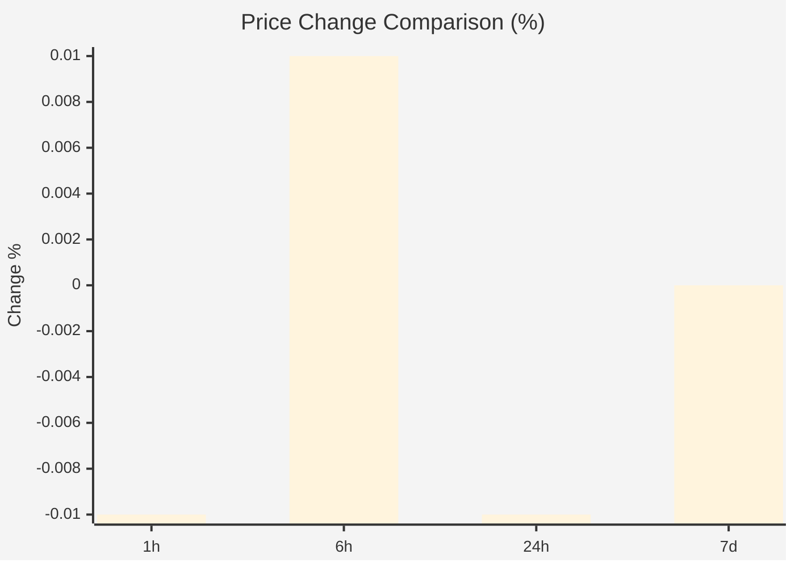
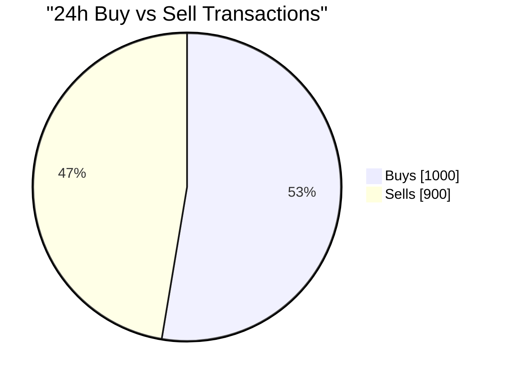
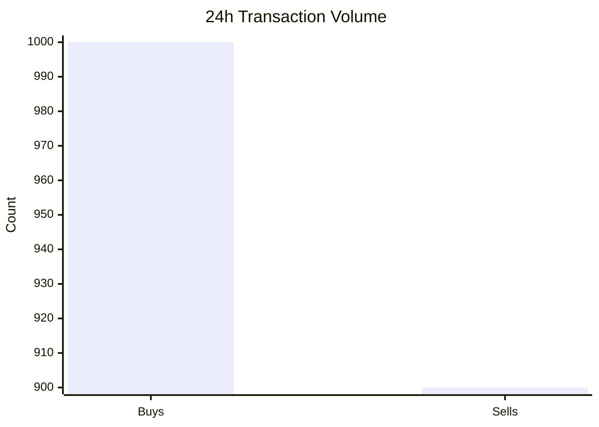
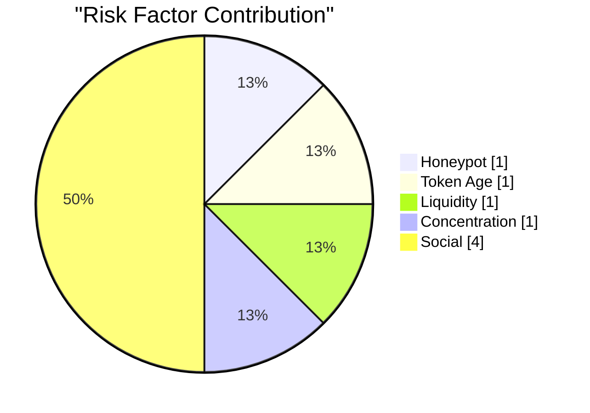

# Token Analysis Report: USDC

**Token Name:** USD Coin  
**Chain:** Ethereum  
**Generated:** 2026-11-10 13:16:39 UTC  
**Contract:** `0xA0b86991c6218b36c1d19D4a2e9Eb0cE3606eB48`

---

## Executive Summary

| Metric | Value |
|--------|-------|
| Price | $0.999900 |
| 24h Change | -0.01% |
| 7d Change | +0.00% |
| 24h Volume | $5.00M |
| 7d Volume | $35.00M |
| Liquidity | $100.00M |
| Market Cap | $30.00B |
| Fully Diluted Valuation | $30.00B |
| Total Holders | 0.00 |

---

## Price Analysis

**Current Price:** $0.999900

### Price Changes

| Period | Change |
|--------|--------|
| 24 Hours | -0.01% |
| 7 Days | +0.00% |

### Price Changes by Period

---

## Volume Analysis

| Period | Volume |
|--------|--------|
| 24 Hours | $5.00M |
| 7 Days | $35.00M |

**Volume/Liquidity Ratio (24h):** 0.05x

---

## Liquidity Analysis

**Total Liquidity:** $100.00M

### Trading Pairs

| DEX | Pair | Liquidity | 24h Volume | Price |
|-----|------|-----------|------------|-------|
| Uniswap V3 | USDC/USDT | $90.00K | $1.00K | $1.000000 |

---

## Top Holders

*No holder data available*

---

## Concentration Analysis

- **Top 10 holders control:** -0.0% of supply
- **Top 50 holders control:** -0.0% of supply
- **Top 100 holders control:** -0.0% of supply

### Interpretation

- 🟢 **Low Concentration:** Top 10 holders control less than 25% of supply. Well-distributed ownership.

---

## Token Information

### Social Media

- 🐦 **Twitter**: [https://twitter.com/circle](https://twitter.com/circle)

---

## Security Analysis

| Check | Status | Details |
|-------|--------|--------|
| Honeypot Risk | 🟢 LOW | 1000 buys / 900 sells (ratio: 1.11) - Normal activity |
| Token Age | 🟢 ESTABLISHED | Created 6.2 years ago |
| Whale Risk | ⚪ UNKNOWN | Holder data not available |
| Social Presence | 🟢 PRESENT | 1 social links, 0 websites |

### 24h Transaction Distribution

### Transaction Activity by Period

| Period | Buys | Sells | Ratio |
|--------|------|-------|-------|
| 1h | 50 | 45 | 1.11 |
| 6h | 300 | 250 | 1.20 |
| 24h | 1000 | 900 | 1.11 |

### Recent Activity

- **1h:** 50 buys, 45 sells
- **6h:** 300 buys, 250 sells
- **24h:** 1000 buys, 900 sells

---

## Risk Score

### Overall Risk: 🟢 1/10 (LOW)

| Factor | Score | Assessment |
|--------|-------|------------|
| Honeypot Risk | 1/10 | Low Risk |
| Token Age | 1/10 | Low Risk |
| Liquidity | 1/10 | Low Risk |
| Concentration | 1/10 | Low Risk |
| Social Presence | 4/10 | Moderate |

### Risk Factor Breakdown

---

## Risk Indicators

### Positive Indicators

- 🟢 **Reasonable distribution** - No extreme concentration in top holders
- 🟢 **Good liquidity** - Sufficient depth for most trades
- 🟢 **Active trading** - Healthy trading volume

---

## Data Sources

- [Block Explorer (Ethereum)](https://etherscan.io/token/0xA0b86991c6218b36c1d19D4a2e9Eb0cE3606eB48)
- [DexScreener](https://dexscreener.com/ethereum/0xA0b86991c6218b36c1d19D4a2e9Eb0cE3606eB48)
- [GeckoTerminal](https://www.geckoterminal.com/ethereum/pools/0xA0b86991c6218b36c1d19D4a2e9Eb0cE3606eB48)

---

*Report generated by Scope v0.8.6 at 2026-11-10 13:16:39 UTC. Always verify data from primary sources.*
---

## Market / Order Book

**Venue:** eth  

| Metric | Value |
|--------|-------|
| Peg Target | 1.000000 |
| Book | synthetic estimate (pool reserves not reported) |
| Best Bid | 0.999000 (-0.100%) |
| Best Ask | 1.001000 (+0.100%) |
| Mid Price | 1.000000 |
| Spread | 0.002000 |
| Volume (24h) | 1000 USD |
| 10k Buy Slippage | 10.00 bps |
| 10k Sell Slippage | 10.00 bps |
| Bid Depth | 45000 |
| Ask Depth | 45000 |
| Healthy | ✗ |

**Health Checks:**
- ✓ No sells below peg
- ✓ Bid/Ask ratio: 1.00x
- ✓ Spread: 0.200% (max 3.0%)
- ✗ Bid levels: 1 < 10 minimum
- ✓ Bid depth: 45000 USD (min 3000)
- ✗ Ask levels: 1 < 10 minimum
- ✓ Ask depth: 45000 USD (min 3000)
- ✓ Bid top-3 depth: 45000 USD (min 300)
- ✓ Bid top-10 depth: 45000 USD (min 2000)
- ✓ Ask top-3 depth: 45000 USD (min 300)
- ✓ Ask top-10 depth: 45000 USD (min 2000)
- ! Depth/volume: ≥9000.0% (≥90000 / 1000 USD within ±2%; target 5–10%)
- – Bot patterns: not checked (a DEX pool has no trade tape here)

---

*Report generated by Scope v0.8.6 at 2026-11-10 13:16:39 UTC. Always verify data from primary sources.*
