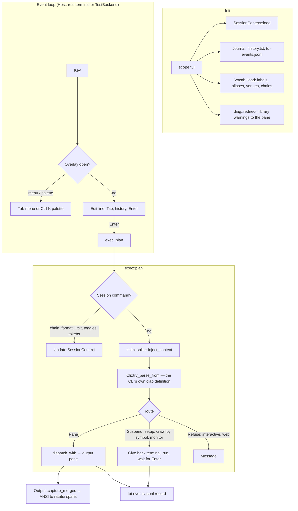

# TUI Dataflow

Dataflow for `scope tui` (also `scope interactive` and `scope shell`): one full-screen ratatui UI that runs every CLI command.

Code: `crates/scope-cli/src/cli/tui/` (`mod.rs` event loop, `exec.rs` parsing and routing, `app.rs` state and rendering, `complete.rs`, `hint.rs`, `palette.rs`, `vocab.rs`, `journal.rs`).

## Routing

`exec::route` matches `Commands` with no wildcard arm, so a new CLI command does not compile until it has a TUI route. `test_every_cli_command_parses_and_has_a_tui_route` walks the clap tree and checks that every subcommand parses and runs from the TUI.

## Context injection

The session context adds a flag only when the target command defines it, accepts the value, and the user did not type it.

| Setting | Default | Becomes | Commands |
|---------|---------|---------|----------|
| chain | auto | `--chain` (only when pinned) | every command with `--chain` |
| format | config default | `--format` (only when it differs and the command accepts the value) | every command with `--format` |
| limit | 100 | `--limit` (only when changed) | address |
| include_tokens / include_txs | false | `--include-tokens` / `--include-txs` | address |
| trace / decode | false | `--trace` / `--decode` | tx |
| last_address / last_tx | — | the missing target | address / tx with no target |

## Learnability

Completion, hints and the palette read `Cli::command()` (after `build()`, so global flags count). Dynamic values come from `Vocab`: address-book labels, token aliases, venue IDs and chains.
